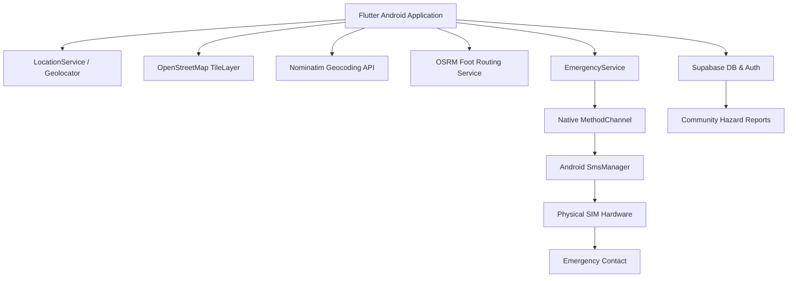

# 🛡️ SafeRoute AI

### Smart Walking Navigation with Safety-Aware Routing & Emergency Assistance


SafeRoute AI is a pedestrian-focused navigation application designed to help users make more informed walking-route decisions using map data, community-reported hazards, route analysis, and emergency assistance features.

> ⚠️ **Notice**: SafeRoute AI is a prototype/research-oriented safety navigation system. It does not guarantee that a route is safe, and real-world conditions can change without notice.

---

## 📖 2. Project Overview

Traditional navigation systems primarily optimize for distance and travel time. For walking pedestrians, however, route safety, sidewalk accessibility, lighting conditions, and hazard awareness are equally vital.

SafeRoute AI adds a safety-oriented layer using available contextual information such as:
* **Community Hazard Reports**: Real-time reporting and visualization of obstacles, dark alleys, waterlogging, and unsafe crossings.
* **Pedestrian Infrastructure**: Mapping and weighting of sidewalks, streetlights, and crosswalks.
* **Deterministic Route Analysis**: Multi-candidate OSRM route comparison weighted against hazard proximity.
* **Direct Emergency SOS Assistance**: Direct cellular SMS emergency dispatch through device SIM hardware.

The system is engineered to work strictly with **available evidence**, avoiding fabricated safety assumptions or arbitrary guarantees.

---

## 🌟 3. Key Features

| Feature | Description |
| :--- | :--- |
| 🗺️ **Walking Navigation** | OpenStreetMap-based pedestrian map rendering via `flutter_map` |
| 📍 **Live Location** | Real-time GPS location tracking with accuracy jitter filtering |
| 🔎 **Destination Search** | Debounced destination geocoding using OpenStreetMap Nominatim |
| 🚶 **Walking Routes** | Foot routing alternatives calculated via OSRM Public API |
| ⚠️ **Hazard Reports** | Community-reported walking hazards with category filters & image upload |
| 🛡️ **Safety-Oriented Routing** | Multi-candidate route evaluation based on hazard proximity & preferences |
| 🚨 **Emergency SOS** | Primary in-app 2-second hold SOS button with a 5-second silent cancellation window |
| 📱 **Direct Offline SMS** | Direct SIM dispatch via Android `SmsManager` without internet dependency |
| 📍 **Emergency Location** | Current/Last-known location embedded as Google Maps link in emergency SMS |
| 🔊 **Volume Trigger** | Foreground 3-press volume key sequence emergency trigger |
| 🔐 **Authentication** | Production Hybrid Auth via Firebase Auth & Supabase DB |
| 🗄️ **Cloud & Offline Sync** | Supabase database sync with `SharedPreferences` offline-first fallback |

---

## 🚨 4. Emergency SOS Workflow

SafeRoute AI features a centralized, production-minded `EmergencyService` designed for critical offline reliability.

```text
User presses and holds SOS for 2 seconds (or 3 Volume Key Presses in Foreground)
                                 ↓
                 Silent 5-second cancellation window
                  ("Emergency alert preparing...")
                                 ↓
                    Fresh GPS location requested
                    (10-second maximum timeout)
                                 ↓
                  Last-known location used if necessary
                (Explicit "Location: Unavailable" if unreachable)
                                 ↓
                        Android SmsManager
                                 ↓
                   Emergency SMS through physical SIM
                                 ↓
             Trusted emergency contact receives alert
```

### Verified Emergency Capabilities:
* **Direct SIM SMS**: Direct SMS operates natively through the device SIM hardware via `SmsManager`.
* **Offline Execution**: SMS dispatch succeeds even when Wi-Fi and Mobile Data are disabled.
* **Location Handling**: Embeds `https://maps.google.com/?q=LAT,LNG`. If fresh location fails, attempts last-known position; if unreachable, sends `Location: Unavailable`. Nagpur coordinates are **never** substituted as fake emergency coordinates.
* **Privacy**: Contact numbers are masked on screen (`+91 ******1234`).
* **Duplicate Protection**: Prevents simultaneous emergency pipelines.

### Trigger Limitations:
* **Foreground Volume Trigger**: ✅ Supported & verified (Active window key listener).
* **Background Volume Trigger**: ⚠️ **Not supported** by the current implementation.
* **Lock-Screen Volume Trigger**: ⚠️ **Not supported** by the current implementation.

---

## ✅ 5. Emergency SOS — Real Device Verification

Verified on a physical Android test device:

| Test Scenario | Result | Verification Notes |
| :--- | :---: | :--- |
| **SOS 2-second hold** | ✅ **PASS** | Progress ring animation & light haptic vibration |
| **Silent 5-second cancel** | ✅ **PASS** | Countdown modal allows instant abort; NO SMS is sent |
| **Direct SIM SMS** | ✅ **PASS** | SMS sent natively through physical SIM card |
| **Offline SMS** | ✅ **PASS** | Dispatches via GSM network with Wi-Fi & Data disabled |
| **Fresh GPS location** | ✅ **PASS** | Accurate GPS coordinates embedded in Google Maps link |
| **Last-known location fallback**| ✅ **PASS** | Successfully falls back to `getLastKnownPosition()` |
| **No-location fallback** | ✅ **PASS** | Sends `Location: Unavailable` if GPS unavailable |
| **SMS permission denial** | ✅ **PASS** | Displays failure notice without application crash |
| **Location permission denial** | ✅ **PASS** | Pipeline completes with `Location: Unavailable` |
| **SMS sent status** | ✅ **PASS** | Dynamic `BroadcastReceiver` confirms `sentIntent` |
| **SMS delivery status** | ✅ **PASS** | Carrier delivery receipt confirmed via `deliveryIntent` |
| **Foreground volume trigger** | ✅ **PASS** | 3 rapid volume presses within 3s triggers SOS |
| **Duplicate prevention** | ✅ **PASS** | Multiple rapid triggers resolve to exactly 1 SMS |
| **Background volume trigger** | ⚠️ **Not supported** | OS restricts key events when app is backgrounded |
| **Lock-screen volume trigger** | ⚠️ **Not supported** | OS locks key dispatch when screen is locked |

### Test Device Hardware:
* **Device Model**: Vivo V2502 / V2502i
* **Android OS**: Android 16 (API Level 36)
* **Flutter SDK**: 3.47.5 • **Dart SDK**: 3.13.4
* **Cellular SIM**: Physical SIM loaded (`LOADED,LOADED`)
* **SMS Received & Link Verified**: Yes

---

## 🏗️ 6. System Architecture



---

## 🛠️ 7. Technology Stack

| Layer | Technology / Package | Function |
| :--- | :--- | :--- |
| **Mobile Framework** | Flutter 3.47.5 | Cross-platform UI framework |
| **Language** | Dart 3.13.4 | Core programming language |
| **Map Rendering** | `flutter_map` (^7.0.2) | OpenStreetMap tile renderer |
| **Geographic Math** | `latlong2` (^0.9.1) | Coordinate math & distance calculations |
| **Location & GPS** | `geolocator` (^13.0.1) | Device GPS location provider |
| **Geocoding** | OSM Nominatim API | Search address resolution |
| **Routing Engine** | OSRM Foot Routing API | Walking path calculation |
| **Database & Storage**| Supabase (`supabase_flutter` ^2.8.0)| Postgres DB, PostGIS, & Storage |
| **Authentication** | Firebase Auth + Supabase DB | Hybrid authentication |
| **Native Android** | Kotlin (`SmsManager`, `PendingIntent`)| Direct offline SMS & volume key listener |
| **Local Persistence**| `shared_preferences` (^2.2.2) | Offline-first contact & preferences storage |

---

## 📁 8. Project Structure

```text
lib/
├── config/
│   ├── safety_config.dart             # Safety scoring thresholds & weights
│   └── supabase_config.dart           # Supabase environment configuration
├── models/
│   ├── emergency_contact.dart         # Emergency contact model & number masking
│   ├── hazard_report.dart             # Community hazard report model
│   ├── location_model.dart            # GPS location model
│   ├── route_candidate.dart           # Multi-candidate route evaluation model
│   ├── route_model.dart               # Polyline points & walking stats
│   ├── safety_score.dart              # Deterministic safety score breakdown
│   ├── trip_summary.dart              # Post-trip analytics model
│   └── user_preferences.dart          # Personal safety avoidance preferences
├── screens/
│   ├── home_screen.dart               # Main map interface with search & SOS button
│   ├── navigation_screen.dart         # Live walking navigation UI
│   ├── profile_screen.dart            # Account & Emergency Contact management
│   ├── preferences_screen.dart        # Safety preference toggle screen
│   └── login_screen.dart              # Authentication screen
├── services/
│   ├── emergency_service.dart         # Centralized Emergency SOS pipeline
│   ├── native_emergency_channel.dart  # Native Android SmsManager MethodChannel
│   ├── emergency_contact_service.dart # Offline-first contact storage service
│   ├── live_navigation_service.dart   # Live turn-by-turn navigation engine
│   ├── safety_engine.dart             # Deterministic safety scoring engine
│   ├── routing_service.dart           # OSRM walking route alternative fetcher
│   ├── location_service.dart          # Device GPS provider
│   └── report_service.dart            # Supabase hazard reports CRUD
└── widgets/
    ├── sos_button.dart                # In-app SOS button (2s hold, progress fill)
    ├── emergency_cancellation_dialog.dart # 5-second silent cancellation modal
    ├── emergency_status_sheet.dart    # Live emergency status & masked contact card
    └── emergency_contact_dialog.dart  # Primary emergency contact config dialog
```

---

## 🧠 9. Safety Model

SafeRoute AI does **not** treat missing information as evidence of safety.

The safety layer is designed to make route decisions more explainable by combining available signals:
* **Community Hazard Reports**: Proximity penalties for active reported hazards (dark areas, waterlogging, road damage).
* **Mapped Infrastructure**: Weightings for street lighting, sidewalk availability, and safe crossings.
* **Deterministic Scoring**: Transparent safety score algorithm (0–100 scale) comparing route alternatives.

---

## 🌐 10. Data Sources

### OpenStreetMap (OSM)
Used for base map tiles and geographic features.
> *Note: OpenStreetMap coverage is community-maintained and may be incomplete or outdated in certain areas.*

### Nominatim
Used for destination address search and geocoding.

### OSRM (Open Source Routing Machine)
Used for calculating pedestrian walking routes.

### Supabase
Used for secure authentication, hazard report storage, and profile data synchronization.

---

## 🔒 11. Privacy & Security

* **Location Sensitivity**: GPS location is used locally for active navigation and embedded in emergency messages only when explicitly triggered.
* **Phone Number Masking**: Emergency contact numbers are masked on-screen (`+91 ******1234`) to prevent public exposure.
* **No Hardcoded Secrets**: Credentials use `--dart-define` or environment configuration.
* **Row Level Security (RLS)**: Supabase database policies restrict unauthorized data access.

---

## 📦 12. Installation & Setup

### Prerequisites
* Flutter SDK (Version 3.47.5 recommended)
* Dart SDK (Version 3.13.4)
* Android Studio & Android SDK (API 36)
* Physical Android device (with SIM for SMS testing) or emulator

### Installation Steps

1. **Clone the Repository**:
   ```bash
   git clone https://github.com/jaybhyemanoj-cyber/SafeRoute-App.git
   cd SafeRoute-App
   ```

2. **Install Dependencies**:
   ```bash
   flutter pub get
   ```

3. **Check Flutter Environment**:
   ```bash
   flutter doctor
   ```

4. **Run Application**:
   ```bash
   flutter run
   ```

---

## 🔑 13. Android Permissions

Defined in `android/app/src/main/AndroidManifest.xml`:

```xml
<uses-permission android:name="android.permission.ACCESS_FINE_LOCATION" />
<uses-permission android:name="android.permission.ACCESS_COARSE_LOCATION" />
<uses-permission android:name="android.permission.INTERNET" />
<uses-permission android:name="android.permission.ACCESS_NETWORK_STATE" />
<uses-permission android:name="android.permission.SEND_SMS" />
<uses-permission android:name="android.permission.VIBRATE" />
```

* **`ACCESS_FINE_LOCATION` & `ACCESS_COARSE_LOCATION`**: Required for live GPS walking navigation and emergency location capture.
* **`SEND_SMS`**: Required for sending emergency SOS messages natively via `SmsManager`.
* **`VIBRATE`**: Required for haptic feedback on SOS button activation.
* **`INTERNET` & `ACCESS_NETWORK_STATE`**: Required for map tile rendering and Supabase data sync.

---

## ⚙️ 14. Configuration

Pass Supabase configuration at build/run time via `--dart-define`:

```bash
flutter run --dart-define=SUPABASE_URL=your-project-url --dart-define=SUPABASE_ANON_KEY=your-anon-key
```

If credentials are not supplied, the app gracefully operates in fallback mode.

---

## 🧪 15. Testing

### Run Automated Unit Tests & Analysis:
```bash
flutter analyze
flutter test
```

These commands verify static code quality, model serialization, phone masking, SMS text generation, and state transitions.

---

## ⚠️ 16. Known Limitations

* **OSM Coverage**: OpenStreetMap data can be incomplete in specific sub-regions.
* **OSRM Public API**: Public OSRM routing servers may experience rate limits during peak usage.
* **Emergency SMS Requirements**: Direct SMS dispatch requires an active SIM card with cellular network service.
* **Volume Trigger Scope**: Foreground volume trigger works only while SafeRoute AI is active in the foreground; background/lock-screen key triggering is not supported by standard Android UI key listeners.
* **Prototype Disclaimer**: SafeRoute AI is a prototype safety navigation aid and is **not** a guaranteed replacement for official emergency services.

---

## 🗺️ 17. Project Roadmap

### Phase 1 — Navigation Foundation (Completed)
* OpenStreetMap integration, GPS location, destination search, OSRM walking routes.

### Phase 2 — Community Safety Data (Completed)
* Supabase backend integration, hazard reporting form, photo upload, map hazard pins.

### Phase 3 — Safety Intelligence (Completed)
* Multi-factor safety engine scoring, route comparison, personalized hazard avoidance toggles.

### Phase 4 — Emergency & Live Assistance (Completed)
* Centralized Emergency SOS system, direct native SIM SMS, 5s silent cancellation window, volume trigger.

### Future Expansion (Planned)
* Background accessibility service for lock-screen emergency triggers.
* Live real-time location sharing link for family members.
* Voice-guided turn-by-turn navigation alerts.

---

## ⚠️ 18. Safety Disclaimer

> ⚠️ **Safety Disclaimer**
>
> SafeRoute AI provides walking navigation and safety information based on available map data, community reports, and deterministic signals. It does not guarantee that any route or location is safe. Conditions can change without notice. Users should remain alert, exercise personal judgment, and contact local emergency services immediately in dangerous situations.
>
> SafeRoute AI is **not** a replacement for official emergency services (e.g., 112 / 911).

---

## 🎬 19. Hackathon Demo Flow

```text
1. Launch SafeRoute AI
2. Grant Location Permission
3. Configure Primary Emergency Contact (e.g., Mom, +91XXXXXXXXXX)
4. Search Destination (e.g., Sitabuldi Fort)
5. Review Route Safety Score & Alternatives
6. Start Live Turn-by-Turn Navigation
7. Press & Hold In-App SOS Button for 2 seconds
8. Observe 5-Second Silent Cancellation Window
9. Verify Native Offline SMS Sent & Delivery Receipt (+ Google Maps Link)
```

---

## 📱 20. Screenshots

> *Add current application screenshots below.*

| Home & Map | Route Comparison | Emergency SOS | Emergency Status |
| :---: | :---: | :---: | :---: |
| *Add Screenshot* | *Add Screenshot* | *Add Screenshot* | *Add Screenshot* |

---

## 🤝 21. Contributing

Contributions are welcome! Please follow these steps:
1. Fork the repository
2. Create your feature branch (`git checkout -b feature/AmazingFeature`)
3. Commit your changes (`git commit -m 'Add some AmazingFeature'`)
4. Run static analysis & tests (`flutter analyze && flutter test`)
5. Push to the branch (`git push origin feature/AmazingFeature`)
6. Open a Pull Request
